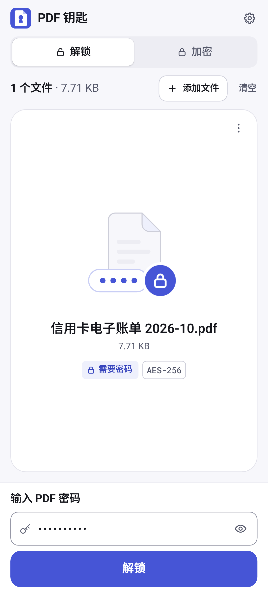
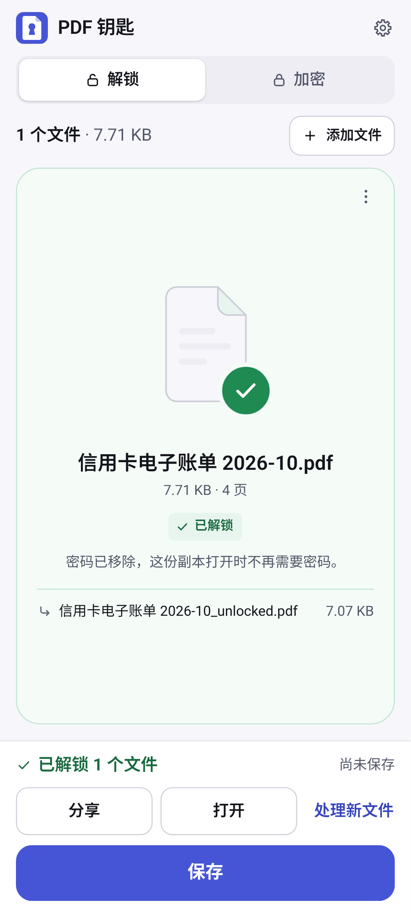
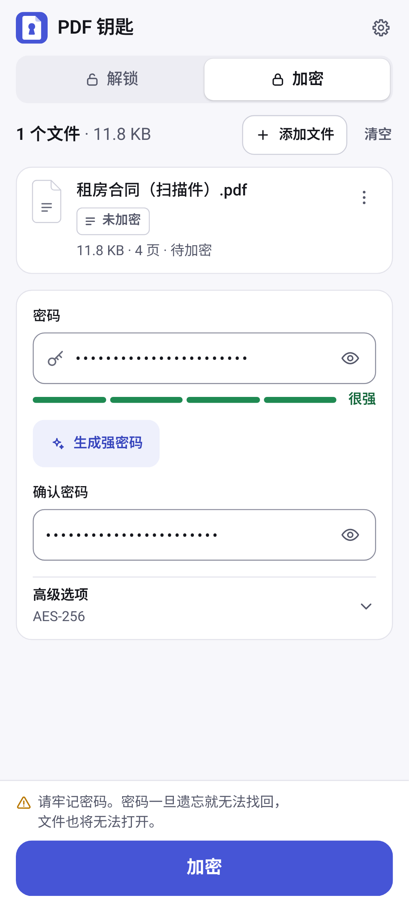
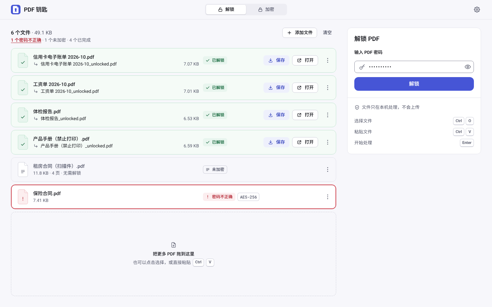

# PDF 钥匙

**简体中文** · [English](#pdf-key)

PDF 钥匙（PDF Key）用来去掉 PDF 的密码保护：你知道密码，想要一份以后打开时不再需要密码的副本。它也能给 PDF 加上密码，或者更换已有的密码和权限。

它是一个可以安装、可以离线使用的网页应用（PWA），主要为 Pixel 手机上的 Chrome 设计，也可以在 macOS 和 Windows 的 Chrome、Edge、Safari、Firefox 中使用。界面有简体中文和英文。

- **文件和密码不会离开设备。** 所有处理都在浏览器里完成（qpdf 编译成的 WebAssembly）。除了加载应用自身的静态文件，应用不发出任何网络请求，也没有统计或跟踪代码；正式构建带有只允许访问自身来源的内容安全策略。
- **可以离线使用。** 第一次打开后，应用的全部文件会缓存到设备上（完成时提示“已可离线使用”），之后断网也能用。
- **密码只在内存里。** 密码不会写入本地存储、地址栏或日志。除了应用自身的离线缓存，保存在设备上的只有设置（语言、主题、文件名后缀、输出选项）。

<p>
  
  
  
</p>



## 目录

- [使用方法](#使用方法)
- [安装](#安装)
- [支持范围](#支持范围)
- [限制](#限制)
- [部署自己的副本](#部署自己的副本)
- [开发](#开发)
- [许可](#许可)

## 使用方法

### 解锁

1. 打开应用，点“选择 PDF”。也可以把文件拖进窗口或直接粘贴；安装之后还可以从其他应用把 PDF 分享过来，或者在电脑上用“打开方式”打开。
2. 输入密码，点“解锁”（或按回车）。
3. 点“保存”。设备支持时还有“分享”；“打开”会在新标签页里查看结果。

- 打开密码和权限密码都可以用来解锁。
- 只有权限限制、打开时不需要密码的文件，不用输入密码，点一下“解除限制”即可。
- 密码不正确时会在原处提示，可以直接重试。
- 结果是一个新文件，默认在文件名后加上 `_unlocked`；原文件不会被改动。
- 每个输出文件都会被重新打开并核对页数，通过后才算完成。
- 文件结构有问题但还能读取时，会自动修复并在卡片上注明。

### 加密

1. 切换到“加密”，选择文件。
2. 设置密码，再输入一次确认（密码处于显示状态时不需要确认）。下方会显示密码强度；“生成强密码”会生成一个 20 位的随机密码，可以复制。
3. 点“加密”，然后保存结果（默认后缀 `_locked`）。完成后可以在结果面板里再次查看和复制所用的密码。

“高级选项”里可以设置：

- **加密算法**：AES-256（默认）或 AES-128（给很旧的阅读器用；密码只能使用英文字母、数字和符号，最多 32 个字符）。
- **单独设置权限密码**：用另一个密码限制打印（允许、仅低分辨率、禁止）、复制文字和图片、修改内容、批注和填写表单、页面整理。这时打开密码可以留空：任何人都能打开文档，但操作受限。权限限制要靠阅读器遵守，不能代替打开密码。
- **加密文档元数据**（默认开启）：标题、作者等信息也一并加密。

其他行为：

- 文件已有保护时，卡片上会要求输入它当前的密码，然后用新的设置替换原有保护；只有权限限制的文件不需要当前密码。
- 一个列表里的结果始终使用同一套加密设置：改了设置再加密时，之前的结果会用新设置重新生成。表单里的设置改动之后、重新加密之前，用旧设置生成的结果会标为“将用新设置重新加密”，暂时不能保存、分享或打开，以免拿到一份用屏幕上看不到的密码加密的文件；把设置改回去，它们就恢复原样。重新加密被取消或失败时，原来的结果仍然保留。
- 密码一旦遗忘就无法找回，文件也将无法打开。

### 批量处理

- 一次可以添加多个文件，也可以把整个文件夹拖进来（读取其中扩展名为 `.pdf` 的文件，最多 500 个、8 层目录）。已在列表里的文件不会重复添加，不是 PDF 的文件会被跳过并提示。
- 解锁时，输入的密码会用于所有需要密码的文件。打不开的文件留在列表里，可以在各自的卡片上换一个密码重试；共用的密码框留空时，“解锁”按钮会逐个尝试卡片上填好的密码。
- 未加密的文件会标为“无需解锁”；只有权限限制的文件直接解除限制。
- 完成后，“全部保存”把结果打包成一个 ZIP；在提供文件夹选择器的浏览器里还可以“保存到文件夹”。每个文件也可以单独保存、打开或分享。同名文件的输出名会自动区分。
- 处理过程中可以取消。切换“解锁 / 加密”不会丢失已添加的文件。

### 文件详情

每个文件卡片右侧的“更多操作”菜单里有“详情”：保护方式、加密算法、密钥长度、PDF 版本、页数、文件大小、元数据是否加密、是否为快速网页预览，以及各项权限。处理完成后还会显示输出文件的大小、处理用时和校验结果。无法处理的文件会显示原因和技术细节。同一个菜单里还可以移除文件，或者重新处理已完成的文件。

### 设置

| 设置               | 作用                                                                                               |
| ------------------ | -------------------------------------------------------------------------------------------------- |
| 语言               | 跟随系统、简体中文、English，立即生效。                                                            |
| 主题               | 系统、浅色、深色。                                                                                 |
| 输出文件名         | 解锁后和加密后的文件名后缀，默认 `_unlocked` 和 `_locked`，最长 32 个字符。                        |
| 处理完成后自动保存 | 完成后直接保存到浏览器的下载位置；多个文件打包成一个 ZIP。默认关闭。                               |
| 优化文件大小       | 压缩文档内部尚未压缩的数据并合并对象，文件通常更小，处理稍慢。默认关闭，此时文档内部数据原样保留。 |
| 快速网页预览       | 把输出线性化，在网页中打开时可以边下载边显示。默认关闭。                                           |
| 安装应用           | 浏览器允许时显示安装按钮，否则说明如何从浏览器菜单安装。                                           |
| 关于               | 应用版本、PDF 引擎版本、隐私说明、开源许可。                                                       |

桌面上的快捷键：`Ctrl`/`⌘` + `O` 选择文件，`Ctrl`/`⌘` + `V` 粘贴文件，`Enter` 开始处理。

## 安装

不安装也能直接在浏览器里使用。安装之后，应用有自己的图标和窗口，并且可以接收其他应用交给它的 PDF。应用在系统里显示的名字是 “PDF Key”。

下面的步骤依据各浏览器的公开行为写成；安装按钮、分享目标和“打开方式”在本项目中只在 Chromium 里通过模拟验证过，没有在实体设备上操作过（见[限制](#限制)）。

### Pixel / Android（Chrome）

1. 用 Chrome 打开应用的地址。
2. 顶栏出现“安装”按钮时点它；没有的话，打开 Chrome 菜单，选“添加到主屏幕”或“安装应用”。“设置”里也有同样的入口。
3. 安装之后，在其他应用（文件、邮件、聊天软件等）里对 PDF 选“分享”，在分享面板里选 “PDF Key”，文件就会出现在应用的列表中。
4. 长按应用图标可以直接进入“解锁”或“加密”。

### macOS

- **Chrome / Edge**：点地址栏右侧的安装图标，或应用顶栏里的“安装”按钮。安装后可以在访达里对 PDF 使用“打开方式”→ PDF Key。
- **Safari 17 及以上**：菜单“文件”→“添加到程序坞”。Safari 不提供安装提示，所以应用里不会出现安装按钮。Safari 里没有“打开方式”和分享目标，文件通过选择、拖放或粘贴添加。

### Windows

- **Chrome / Edge**：点地址栏右侧的安装图标，或应用顶栏里的“安装”按钮。安装后可以在资源管理器里右键 PDF →“打开方式”→ PDF Key。

### Firefox

桌面版 Firefox 不支持安装网页应用，可以在标签页里直接使用，离线同样可用。

### 更新

有新版本时应用会提示“有新版本可用”，点“刷新”才会切换。有文件正在处理或结果尚未保存时，这个提示会等到之后再出现。同时开着几个窗口时，一个窗口切换到新版本不会打断其他窗口：它们继续使用原来的版本，所需的文件会保留到不再有窗口使用为止（最长 30 天）。

## 支持范围

以下内容来自代码和测试（`tests/fixtures/` 里的 PDF 由 qpdf（经 pikepdf）、pypdf 和 ReportLab 写出）。

### 可以打开的加密格式

仅限 PDF 标准的密码加密（standard security handler）：

| 算法       | 修订（R） | 说明                                   |
| ---------- | --------- | -------------------------------------- |
| RC4 40 位  | R2        | 已过时，应用会提示                     |
| RC4 128 位 | R3、R4    | 已过时，应用会提示                     |
| AES-128    | R4        | PDF 1.6                                |
| AES-256    | R5        | Adobe 的早期方案（扩展级别 3），已弃用 |
| AES-256    | R6        | PDF 2.0                                |

测试覆盖的情况还包括：打开密码与权限密码不同、相同、只有权限密码；元数据未加密；对象流和交叉引用流；线性化文件；带附件的文件；文件头之前有多余字节；`startxref` 错误但可以修复的文件。

### 写出的加密格式

- AES-256（R6），默认。
- AES-128（R4），给不支持 AES-256 的旧阅读器用。
- 不提供 RC4：它已经不安全。

可以设置的权限：打印（完全、仅低分辨率、禁止）、修改内容、复制文字和图片、批注和填写表单、页面整理。引擎写出的文件总是允许辅助功能读取。

### 密码的处理

PDF 里的密码是字节串，同样的文字在不同软件里可能被存成不同的字节。输入密码时照常输入即可，应用会按文件的加密方式依次尝试各种编码：

- **AES-256（R5、R6）**：先按 SASLprep（RFC 4013）规范化，再编码为 UTF-8，最多 127 字节（约 42 个汉字）。这种形式打不开时，还会尝试未规范化的 UTF-8、NFC、NFKC、NFD，以及下面的旧编码。
- **RC4、AES-128（R2–R4）**：标准规定使用 PDFDocEncoding，最多 32 字节。实际中很多软件直接使用了系统编码，所以会依次尝试 PDFDocEncoding、Windows-1252、Latin-1、UTF-8、GBK、Big5、Shift_JIS、EUC-JP、EUC-KR、Windows-1251 等代码页（完整列表见 [engine/README.md](engine/README.md)）。
- 密钥校验是密码学意义上的：多试几种编码不会让错误的密码打开文件。
- 加密时，AES-256 使用 SASLprep 加 UTF-8（最多 127 字节），AES-128 使用 PDFDocEncoding（最多 32 字节）。AES-128 无法表示的字符（例如中文）会被拒绝，并提示改用 AES-256。
- 密码不能包含零字节。

### 文件大小和内存

- 引擎不会把整个文件读进内存：输入按需分块读取，缓存默认 64 MiB（Chromium 报告设备内存不超过 4 GiB 时为 32 MiB，不超过 2 GiB 时为 16 MiB）；输出以 1 MiB 的块直接写成浏览器的 Blob。处理在 Web Worker 中进行，最多 4 个并行。
- 内存占用是缓存加上文件里最大的单个流的几倍，与文件总大小无关。一个流就有几百 MB 的 PDF 需要相应更多的内存，超过浏览器允许的范围时会以“内存不足”失败；引擎模块的上限是 4 GiB。
- [engine/README.md](engine/README.md) 记录的实测数字（开发机，4 核，Node 22.23；测试文件每页一张 1 MiB 的图片；解密）：

  | 文件            | 用时    | WebAssembly 内存 |
  | --------------- | ------- | ---------------- |
  | 100 MB，AES-256 | 0.90 秒 | 96 MB            |
  | 500 MB，AES-256 | 4.59 秒 | 96 MB            |
  | 500 MB，AES-128 | 3.71 秒 | 96 MB            |
  | 4.7 GB，AES-256 | 41.4 秒 | 115 MB           |

  在无头 Chromium 158 中经由 worker 解密同一个 100 MB 文件，用时 1.15–1.4 秒（含输出校验）。

- 端到端测试会在应用里解锁一个约 30 MB 的 AES-256 文件（有进度、可取消、页面保持响应），并验证 66 MB 和 258 MB 的文件经由分享目标完整到达；这些都在无头 Chromium 中进行。没有在手机上测量过大文件。

## 限制

- **不破解密码。** 应用只能移除你知道的密码；只有权限限制的文件除外，这类文件本来就不需要密码即可打开。
- **只在 Chromium 中测试过。** 自动化测试全部运行在 Playwright 自带的 Chromium（无头模式）里，用模拟的 Pixel 尺寸（412×915，触摸）和桌面窗口（1440×900）。没有实体 Pixel 手机，也没有 Safari、Firefox、真实的 macOS 或 Windows 环境可用，这些都没有实际运行过。
- **对其他浏览器只做过静态核对。** 将构建产物用到的 API、语法和 CSS 与 @mdn/browser-compat-data 8.1.11 对照，结论是：应用依赖的功能在 Chrome / Edge 120、Safari 17、Firefox 128 及以上版本中都具备，可选功能都有检测和退路。核对中记下的差异：
  - Safari 和 Firefox 没有“保存为…”和文件夹选择器：单个文件改为下载，多个文件打包为 ZIP 下载。按该数据，Android 版 Chrome 自 132 起提供这两个选择器。
  - Firefox 不能分享文件，分享按钮不显示。
  - Safari 和 Firefox 不支持分享目标、“打开方式”和安装提示；桌面版 Firefox 不能安装网页应用。
  - Firefox 不支持 `text-wrap: pretty`（Safari 自 26 起支持），说明文字的换行位置会略有不同。
  - 该数据把 `focus({ preventScroll })` 标为 Android 版 Chrome 不支持。应用在把焦点移到浮层、菜单和文件卡片时用到它；如果它在手机上确实被忽略，聚焦时页面可能会滚动。这一点无法在这里验证。
  - 浏览器的无痕窗口等没有 service worker 的环境里，应用只能联网使用。
- **不支持证书加密**（公钥安全处理器）、第三方插件或 DRM 的加密，以及未知的加密修订；这些文件会报告为“不支持的加密方式”。
- **损坏的文件**：能修复的会修复并注明。加密的文件如果在下载中途被截断、丢了文件尾，会被报告为“文件已损坏”而不是被当作未加密文件处理；个别同样丢了文件尾的未加密文件也会因此被拒绝（详见 [engine/README.md](engine/README.md) 的 “Known limits”）。
- 从其他应用分享过来的文件会先暂存在浏览器的缓存存储里，应用取走后即删除；15 分钟内没有被取走的不会再交给应用。暂存期间，设备的存储空间需要容得下整个文件。
- 加密时设置的密码会在内存中保留到结果被清空为止，以便在结果面板里查看和复制；为已有保护的文件重新加密时，它原来的密码也会在内存中保留到那时（不显示）。清空列表或关闭页面后即丢弃。

## 部署自己的副本

构建结果是一组静态文件，所有地址都是相对的，可以放在任何路径下。

### GitHub Pages

仓库里已有工作流 [.github/workflows/deploy.yml](.github/workflows/deploy.yml)：

1. 把代码放到你自己的 GitHub 仓库（fork 或推送）。
2. 在仓库的 Settings → Pages → Build and deployment 中，把 Source 设为 “GitHub Actions”。
3. 推送到 `main` 分支（或在 Actions 页面手动运行 “Deploy to GitHub Pages”）。工作流会运行单元测试、构建并发布 `dist/`。
4. 应用的地址是 `https://<用户名>.github.io/<仓库名>/`。

私有仓库使用 GitHub Pages 需要付费方案。

### 其他静态托管

```sh
npm ci
npm run build
```

然后把 `dist/` 里的全部内容上传到任意静态服务器。要求：

- **HTTPS**。离线缓存、安装和分享目标都需要安全上下文（本机调试时 `http://localhost` 也算）。
- **路径不限**。可以是域名根目录，也可以是子路径；每个部署地址是一个独立的应用。
- 最好以 `application/wasm` 提供 `.wasm` 文件；其他类型也能工作，只是不能边下载边编译。
- 不需要配置响应头：内容安全策略写在 `index.html` 的 `<meta>` 里。
- 不要给 `index.html` 和 `sw.js` 设置长期缓存，否则更新无法及时到达；`assets/` 下的文件名带有内容哈希，可以长期缓存。

`npm run preview` 可以在本机预览构建结果（`http://localhost:4173/`）。

## 开发

### 准备

- Node.js 22（22.12 或更高；CI 使用 22）和 npm。
- 端到端测试需要 Playwright 的 Chromium：`npx playwright install chromium`。
- 不需要 Emscripten：编译好的引擎（`src/engine/dist/`）已经在仓库里。只有重新编译引擎时才需要。

```sh
npm ci
npm run dev
```

### 命令

| 命令                  | 作用                                                                                                                                            |
| --------------------- | ----------------------------------------------------------------------------------------------------------------------------------------------- |
| `npm run dev`         | 开发服务器（默认 `http://localhost:5173/`）。                                                                                                   |
| `npm run build`       | 类型检查并构建到 `dist/`。                                                                                                                      |
| `npm run preview`     | 在本机提供 `dist/`。                                                                                                                            |
| `npm test`            | 单元测试和集成测试（Vitest）。`npm run test:watch` 为监视模式。                                                                                 |
| `npm run e2e`         | 端到端测试（Playwright）。会自己构建，并占用 4173 和 5173 端口，运行前请先停掉开发服务器。                                                      |
| `npm run typecheck`   | 仅类型检查。                                                                                                                                    |
| `npm run format`      | 用 Prettier 格式化；`npm run format:check` 只检查。                                                                                             |
| `npm run screenshots` | 构建并重新生成 `public/screenshots/` 里的截图（[scripts/generate-screenshots.mjs](scripts/generate-screenshots.mjs)，需要 Node 22.18 或更高）。 |

端到端测试可以只运行一部分：`npm run e2e -- --project=phone`（项目有 `phone`、`desktop`、`layout`），或 `npm run e2e -- unlock`（一个文件）。

### 开发用的模拟引擎

开发服务器上给地址加 `?fake`，应用会改用一个按文件名决定行为的模拟引擎（[tests/support/fake-engine.ts](tests/support/fake-engine.ts)），方便手动走到界面的每一种状态：

- `http://localhost:5173/?fake&demo` 启动时载入全部演示文件；`?fake&demo=plain.pdf,slow.pdf` 只载入指定的几个。演示文件的密码是 `1234`，权限密码是 `owner`。
- `window.__pdfkey` 提供状态模块，供控制台使用。

这些只存在于开发构建中，正式构建不包含。

### 重新编译引擎

引擎是 qpdf 12.4.2 加一层 C++ 封装（[engine/src/pdfx.cc](engine/src/pdfx.cc)），用 Emscripten 7.0.1 编译：

```sh
engine/build.sh
```

依赖、编译参数、可复现性和各项检查见 [engine/README.md](engine/README.md)。[.github/workflows/engine.yml](.github/workflows/engine.yml) 可以手动触发，在固定版本的容器里重新编译并上传结果。

### 目录结构

```
index.html              页面入口
public/                 boot.js（首屏之前应用主题和语言）、图标、截图
src/main.tsx, app.tsx   入口和根组件
src/ui/                 Preact 组件
src/styles/             CSS；tokens.css 定义颜色、间距等变量
src/state/              状态（signals）：设置、文件列表和任务、加密表单、浮层、提示
src/i18n/               文案：以 zh-CN.ts 为准，en.ts 与之对应
src/lib/                文件名、CRC-32、ZIP、保存和分享、密码强度、密码生成
src/pwa/                service worker、安装、接收分享和“打开方式”、更新
src/engine/             引擎的 TypeScript 接口和 worker；dist/ 是编译好的 WebAssembly
engine/                 引擎的构建脚本、C++ 封装和检查工具
scripts/                生成图标、截图和第三方许可文件
tests/fixtures/         测试用的 PDF 和描述它们的 manifest.json
tests/e2e/              端到端测试
tests/unit/             不属于某个模块的单元测试
tests/support/          模拟引擎和测试辅助代码
.github/workflows/      ci.yml、deploy.yml、engine.yml
```

### 测试的组织

- **单元和集成测试**（Vitest，Node 环境）：与被测代码放在一起，即 `src/**/*.test.ts`，另有 `tests/unit/`。引擎的测试在 Node 里运行真实的 WebAssembly 模块，对 `tests/fixtures/` 的每个文件做检查、解密、加密再解密；状态层的测试大多使用模拟引擎，`src/state/jobs.integration.test.ts` 使用真实引擎。
- **端到端测试**（Playwright，`tests/e2e/`）：针对正式构建和真实引擎。`phone` 项目模拟 Pixel（412×915，简体中文），`desktop` 项目是 1440×900 的英文窗口，两者运行相同的用例；`layout` 项目在多种窗口尺寸、语言和主题下检查布局。`a11y.spec.ts` 用 axe 检查无障碍，`pwa.spec.ts` 检查离线、分享目标、更新以及在子路径下的运行。每个用例在应用报出错误、违反内容安全策略或访问其他来源时都会失败。
- 布局测试按 Pixel 的字体（Roboto 和 Noto Sans SC）测量文字宽度；`tests/e2e/support/fonts.conf` 是 CI 使用的字体配置。
- **引擎的额外检查**（与 pikepdf、pypdf、原生 qpdf 交叉验证，真实浏览器检查，大文件基准）见 [engine/README.md](engine/README.md)；测试用 PDF 的来源见 [tests/fixtures/README.md](tests/fixtures/README.md)。
- CI（[.github/workflows/ci.yml](.github/workflows/ci.yml)）在每次推送时依次运行类型检查、单元测试、格式检查、构建和端到端测试。

## 许可

PDF 钥匙以 GNU Affero 通用公共许可证第 3 版发布，全文见 [LICENSE](LICENSE)。

应用包含以下开源组件：qpdf（Apache-2.0）、zlib、libjpeg（Independent JPEG Group）、Emscripten 运行时及其附带的 musl、LLVM 运行库和 dlmalloc，以及 Preact、Preact Signals、Workbox 和 Vite / Rolldown 的模块加载辅助代码。它们的版权声明和许可全文在随每个构建一同发布的 `licenses.txt` 里（应用内：设置 → 关于 → 开源许可 →“查看许可全文（英文）”）。这个文件由 [scripts/third-party-notices.ts](scripts/third-party-notices.ts) 根据 [engine/THIRD_PARTY_NOTICES.md](engine/THIRD_PARTY_NOTICES.md) 和已安装的依赖包在构建时生成。

本软件部分基于 Independent JPEG Group 的工作成果。

---

# PDF Key

[简体中文](#pdf-钥匙) · **English**

PDF Key (PDF 钥匙) removes the password protection of a PDF: you know the password and want a copy that opens without it. It can also add a password to a PDF, or replace the password and permissions a PDF already has.

It is an installable web app (PWA) that works offline. It is designed first for Chrome on a Pixel phone and also runs in Chrome, Edge, Safari and Firefox on macOS and Windows. The interface is available in Simplified Chinese and English.

- **Files and passwords never leave the device.** All processing happens in the browser (qpdf compiled to WebAssembly). Apart from loading its own static files the app makes no network requests, and it contains no analytics or tracking code; the production build carries a Content-Security-Policy that only allows its own origin.
- **It works offline.** After the first visit every file of the app is cached on the device (the app says “Ready to work offline” when that is done) and no network is needed any more.
- **Passwords exist in memory only.** They are never written to local storage, the address bar or a log. Besides the offline cache of the app itself, the only thing kept on the device is the settings (language, theme, file-name suffixes, output options).

<p>
  
  
  
</p>


The screenshots show the Simplified Chinese interface.

## Contents

- [How to use it](#how-to-use-it)
- [Installing](#installing)
- [What it supports](#what-it-supports)
- [Limits](#limits)
- [Deploying your own copy](#deploying-your-own-copy)
- [Development](#development)
- [Licence](#licence)

## How to use it

### Unlock

1. Open the app and press “Choose PDFs”. You can also drop files onto the window or paste them; once the app is installed, other apps can share PDFs to it and a computer can open PDFs with it.
2. Type the password and press “Unlock” (or Enter).
3. Press “Save”. Where the device supports it there is also “Share”; “Open” shows the result in a new tab.

- Both the open password and the permissions password unlock a file.
- A file that only carries restrictions and opens without a password needs no password: one press on “Remove restrictions” is enough.
- A wrong password is reported in place and can be corrected right there.
- The result is a new file whose name gets the suffix `_unlocked` by default; the original is not modified.
- Every output file is opened again and its page count compared before it counts as done.
- A file whose structure is damaged but still readable is repaired, and its card says so.

### Lock

1. Switch to “Lock” and choose files.
2. Set a password and type it again to confirm (no confirmation is needed while the password is shown). A meter rates its strength; “Generate strong password” creates a random password of 20 characters that can be copied.
3. Press “Lock”, then save the result (default suffix `_locked`). The result panel lets you look at the password that was used, and copy it, once more.

“Advanced options” offers:

- **Encryption**: AES-256 (the default) or AES-128 (for very old readers; the password may only use letters, digits and symbols, 32 characters at most).
- **Separate permissions password**: a second password that restricts printing (allowed, low resolution, not allowed), copying text and images, editing content, commenting and filling in forms, and organising pages. The open password may then be left empty: anyone can open the document, with those restrictions. Restrictions rely on the reader honouring them and are no substitute for an open password.
- **Encrypt document metadata** (on by default): title, author and similar details are encrypted too.

Also:

- When a file is already protected, its card asks for the current password and the protection is replaced by the new settings; a file that only carries restrictions needs no current password.
- The results of one list always share one set of lock settings: when you lock again with other settings, the earlier results are made again with them. Between a change in the form and that run, a result made with the earlier settings is marked “Will be locked again with the new settings” and cannot be saved, shared or opened, so that no file leaves with a password that is not on screen; put the settings back and it is on offer again. If the new run is cancelled or fails, the earlier result is kept.
- A forgotten password cannot be recovered, and the file cannot be opened without it.

### Several files at once

- Add any number of files, or drop a whole folder (the files in it whose names end in `.pdf` are taken, up to 500 files and 8 levels deep). A file that is already in the list is not added twice, and files that are not PDFs are skipped with a message.
- When unlocking, the password you type is tried on every file that needs one. Files it does not open stay in the list and can be retried with another password on their own cards; with the shared field left empty, the Unlock button tries what was typed on the cards.
- Files that are not encrypted are marked “Nothing to unlock”; files that only carry restrictions are simply freed of them.
- Afterwards “Save all” bundles the results into one ZIP; browsers with a folder picker also offer “Save to folder”. Every file can be saved, opened or shared by itself too. Outputs of files with the same name get distinct names.
- Processing can be cancelled. Switching between Unlock and Lock keeps the files.

### File details

The “More actions” menu on each file card has “Details”: kind of protection, encryption algorithm, key length, PDF version, page count, file size, whether the metadata is encrypted, whether the file is prepared for fast web view, and every permission. After processing it also shows the size of the output, the time taken and the result of the verification. A file that cannot be processed shows the reason and the technical detail. The same menu removes a file, or processes a finished file again.

### Settings

| Setting                      | What it does                                                                                                                                                                                                     |
| ---------------------------- | ---------------------------------------------------------------------------------------------------------------------------------------------------------------------------------------------------------------- |
| Language                     | System default, 简体中文 or English; changes at once.                                                                                                                                                            |
| Theme                        | System, Light or Dark.                                                                                                                                                                                           |
| Output file names            | The suffixes added after unlocking and after locking: `_unlocked` and `_locked` by default, 32 characters at most.                                                                                               |
| Save automatically when done | Results go straight to the browser’s download location; several files are bundled into one ZIP. Off by default.                                                                                                  |
| Optimise file size           | Compresses data inside the document that is not compressed yet and packs objects together: usually a smaller file, a little slower. Off by default, in which case the data inside the document is kept as it is. |
| Fast web view                | Linearizes the output so that it can be displayed while it is still downloading. Off by default.                                                                                                                 |
| Install app                  | The install button where the browser offers installation, otherwise a hint about the browser menu.                                                                                                               |
| About                        | App version, version of the PDF engine, the privacy statement, open-source licences.                                                                                                                             |

Keyboard shortcuts on desktop: `Ctrl`/`⌘` + `O` chooses files, `Ctrl`/`⌘` + `V` pastes files, `Enter` starts.

## Installing

The app works in a browser tab without being installed. Installed, it has its own icon and window and can receive PDFs from other apps. The system shows it under the name “PDF Key”.

The steps below describe how the browsers are documented to behave. In this project the install button, the share target and “open with” have only been verified in Chromium, by emulation, and never on a physical device (see [Limits](#limits)).

### Pixel / Android (Chrome)

1. Open the address of the app in Chrome.
2. Press “Install” in the top bar when it appears; otherwise open the Chrome menu and choose “Add to Home screen” or “Install app”. Settings has the same entry.
3. From then on, choose “Share” on a PDF in another app (Files, mail, a messenger) and pick “PDF Key” in the share sheet: the file appears in the app’s list.
4. A long press on the app icon leads straight to Unlock or Lock.

### macOS

- **Chrome / Edge**: press the install icon at the right end of the address bar, or “Install” in the app’s top bar. Afterwards Finder offers PDF Key under “Open With” for PDFs.
- **Safari 17 or newer**: File → Add to Dock. Safari has no install prompt, so the app shows no install button there. Safari has neither “open with” nor a share target for web apps; add files by choosing, dropping or pasting them.

### Windows

- **Chrome / Edge**: press the install icon at the right end of the address bar, or “Install” in the app’s top bar. Afterwards right-click a PDF in Explorer → “Open with” → PDF Key.

### Firefox

Firefox on desktop cannot install web apps. The app works in a tab, offline included.

### Updates

When a new version is available the app says so, and switches to it only when you press “Refresh”. While files are being processed or results have not been saved, the offer waits. With several windows open, one window switching to the new version does not interrupt the others: they keep running the version they loaded, whose files are kept until no window needs them (30 days at most).

## What it supports

What follows is taken from the code and the tests (the PDFs in `tests/fixtures/` were written by qpdf, through pikepdf, by pypdf and by ReportLab).

### Encryption it opens

The standard password security handler of PDF only:

| Algorithm   | Revision (R) | Notes                                                |
| ----------- | ------------ | ---------------------------------------------------- |
| RC4 40-bit  | R2           | Outdated; the app says so                            |
| RC4 128-bit | R3, R4       | Outdated; the app says so                            |
| AES-128     | R4           | PDF 1.6                                              |
| AES-256     | R5           | Adobe’s early scheme (extension level 3), deprecated |
| AES-256     | R6           | PDF 2.0                                              |

The tests also cover: different, identical and owner-only passwords; unencrypted metadata; object streams and cross-reference streams; linearized files; files with attachments; bytes in front of the file header; and files with a wrong `startxref` that can be repaired.

### Encryption it writes

- AES-256 (R6), the default.
- AES-128 (R4), for old readers without AES-256.
- Never RC4: it is broken.

Permissions that can be set: printing (full, low resolution, none), editing content, copying text and images, commenting and filling in forms, organising pages. Files written by the engine always allow extraction for accessibility.

### Passwords

A PDF password is a byte string, and the same text may have been stored as different bytes by different software. Type the password as usual; the app tries the encodings that fit the file’s encryption, in order:

- **AES-256 (R5, R6)**: normalised with SASLprep (RFC 4013), then encoded as UTF-8, 127 bytes at most (about 42 Chinese characters). If that does not open the file, UTF-8 without normalisation, NFC, NFKC and NFD are tried, then the legacy encodings below.
- **RC4 and AES-128 (R2–R4)**: the standard asks for PDFDocEncoding, 32 bytes at most. In practice many writers used whatever the system handed them, so PDFDocEncoding, Windows-1252, Latin-1, UTF-8, GBK, Big5, Shift_JIS, EUC-JP, EUC-KR, Windows-1251 and further code pages are tried (the full list is in [engine/README.md](engine/README.md)).
- The key check is cryptographic: trying more encodings cannot make a wrong password open a file.
- For locking, AES-256 uses SASLprep and UTF-8 (127 bytes at most), AES-128 uses PDFDocEncoding (32 bytes at most). Characters AES-128 cannot represent, Chinese for example, are refused with the advice to use AES-256.
- A password cannot contain a zero byte.

### File size and memory

- The engine never holds a whole file in memory: input is read in blocks on demand through a cache of 64 MiB by default (32 MiB when Chromium reports a device memory of 4 GiB or less, 16 MiB at 2 GiB or less), and output is written as browser Blobs in chunks of 1 MiB. The work runs in Web Workers, up to four in parallel.
- Memory use is the cache plus a few times the largest single stream of the file, not a function of the file size. A PDF with one stream of several hundred megabytes needs correspondingly more and fails with “Not enough memory” when that exceeds what the browser grants; the hard ceiling of the engine module is 4 GiB.
- Numbers measured for [engine/README.md](engine/README.md) (development machine, 4 cores, Node 22.23; test files with one 1 MiB image per page; decryption):

  | File            | Time   | WebAssembly memory |
  | --------------- | ------ | ------------------ |
  | 100 MB, AES-256 | 0.90 s | 96 MB              |
  | 500 MB, AES-256 | 4.59 s | 96 MB              |
  | 500 MB, AES-128 | 3.71 s | 96 MB              |
  | 4.7 GB, AES-256 | 41.4 s | 115 MB             |

  In headless Chromium 158, through a worker, the same 100 MB file takes 1.15–1.4 s including the verification of the output.

- The end-to-end tests unlock a file of about 30 MB (AES-256) in the app, with progress, cancellation and a page that stays responsive, and verify that files of 66 MB and 258 MB arrive whole through the share target; all of it in headless Chromium. Large files have not been measured on a phone.

## Limits

- **It does not crack passwords.** It removes a password you know. Files that only carry restrictions are the exception, and those open without a password anyway.
- **It has been tested in Chromium only.** All automated tests run in the Chromium that comes with Playwright, headless, with the emulated size of a Pixel (412×915, touch) and a desktop window (1440×900). No physical Pixel phone, no Safari, no Firefox and no real macOS or Windows machine was available; none of them has been run.
- **Other browsers were audited statically, not run.** The APIs, syntax and CSS found in the build output were compared with @mdn/browser-compat-data 8.1.11. Result: nothing the app depends on is missing in Chrome / Edge 120, Safari 17, Firefox 128 or newer, and every optional feature is detected and has a fallback. Differences the audit noted:
  - Safari and Firefox have no “save as” and folder pickers: a single file is downloaded, several files are downloaded as one ZIP. According to that data, Chrome on Android has both pickers from version 132.
  - Firefox cannot share files; the share buttons are not shown.
  - Safari and Firefox have no share target, no “open with” and no install prompt. Firefox on desktop cannot install web apps at all.
  - Firefox does not support `text-wrap: pretty` (Safari does from version 26), so explanatory text breaks its lines slightly differently.
  - The data lists `focus({ preventScroll })` as unsupported in Chrome on Android. The app uses it when it moves the focus to sheets, menus and file cards; if it really is ignored on the phone, focusing can scroll the page. This could not be verified here.
  - Where there is no service worker, as in the private windows of some browsers, the app only works online.
- **No certificate encryption** (public-key security handler), no encryption by third-party plug-ins or DRM, and no unknown encryption revisions; such files are reported as “Unsupported encryption”.
- **Damaged files**: what can be repaired is repaired, with a note. An encrypted file that was cut off during a download and lost its end is reported as “File is damaged” instead of being taken for an unencrypted one; a few unusual unencrypted files that lost their end as well are refused for the same reason (see “Known limits” in [engine/README.md](engine/README.md)).
- Files shared from another app are parked in the browser’s cache storage and deleted as soon as the app has collected them; files not collected within 15 minutes are no longer handed to the app. While a file is parked, the device needs room for all of it.
- The password set for locking stays in memory until the results are cleared, so that the result panel can show and copy it; when an already protected file is locked again, its previous password stays in memory until then as well, never shown. Clearing the list or closing the page drops them.

## Deploying your own copy

The build is a set of static files in which every address is relative, so it can live under any path.

### GitHub Pages

The repository contains the workflow [.github/workflows/deploy.yml](.github/workflows/deploy.yml):

1. Put the code into a GitHub repository of your own (fork or push).
2. In the repository, open Settings → Pages → Build and deployment and set Source to “GitHub Actions”.
3. Push to the `main` branch (or run “Deploy to GitHub Pages” by hand on the Actions page). The workflow runs the unit tests, builds, and publishes `dist/`.
4. The app is at `https://<user>.github.io/<repository>/`.

GitHub Pages for a private repository needs a paid plan.

### Any other static host

```sh
npm ci
npm run build
```

Then upload everything in `dist/` to any static server. Requirements:

- **HTTPS.** The offline cache, installation and the share target need a secure context (`http://localhost` counts while testing on your own machine).
- **Any path.** The root of a domain or a sub-path; every address the app is deployed to is an app of its own.
- Serve `.wasm` files as `application/wasm` if you can. Other types work too, without compiling while downloading.
- No response headers are needed: the Content-Security-Policy is a `<meta>` tag in `index.html`.
- Do not give `index.html` and `sw.js` a long cache lifetime, or updates arrive late; the files under `assets/` have content hashes in their names and can be cached for good.

`npm run preview` serves the build locally (`http://localhost:4173/`).

## Development

### Prerequisites

- Node.js 22 (22.12 or newer; CI uses 22) and npm.
- The end-to-end tests need Playwright’s Chromium: `npx playwright install chromium`.
- No Emscripten: the compiled engine (`src/engine/dist/`) is in the repository. It is only needed to rebuild the engine.

```sh
npm ci
npm run dev
```

### Scripts

| Command               | What it does                                                                                                                                                           |
| --------------------- | ---------------------------------------------------------------------------------------------------------------------------------------------------------------------- |
| `npm run dev`         | Development server (`http://localhost:5173/` by default).                                                                                                              |
| `npm run build`       | Type check, then build into `dist/`.                                                                                                                                   |
| `npm run preview`     | Serves `dist/` locally.                                                                                                                                                |
| `npm test`            | Unit and integration tests (Vitest); `npm run test:watch` watches.                                                                                                     |
| `npm run e2e`         | End-to-end tests (Playwright). Builds by itself and uses ports 4173 and 5173, so stop the development server first.                                                    |
| `npm run typecheck`   | Type check only.                                                                                                                                                       |
| `npm run format`      | Formats with Prettier; `npm run format:check` only checks.                                                                                                             |
| `npm run screenshots` | Builds, then renders the screenshots in `public/screenshots/` again ([scripts/generate-screenshots.mjs](scripts/generate-screenshots.mjs), needs Node 22.18 or newer). |

Part of the end-to-end suite: `npm run e2e -- --project=phone` (the projects are `phone`, `desktop` and `layout`) or `npm run e2e -- unlock` (one file).

### The fake engine for development

On the development server, `?fake` in the address makes the app use a scripted engine whose behaviour depends on the file name ([tests/support/fake-engine.ts](tests/support/fake-engine.ts)), so that every state of the interface can be reached by hand:

- `http://localhost:5173/?fake&demo` loads every demo file at start; `?fake&demo=plain.pdf,slow.pdf` loads the ones named. The password of the demo files is `1234`, their permissions password `owner`.
- `window.__pdfkey` exposes the state modules to the console.

None of this is part of a production build.

### Rebuilding the engine

The engine is qpdf 12.4.2 with a C++ wrapper ([engine/src/pdfx.cc](engine/src/pdfx.cc)), compiled with Emscripten 7.0.1:

```sh
engine/build.sh
```

Requirements, flags, reproducibility and the checks are described in [engine/README.md](engine/README.md). [.github/workflows/engine.yml](.github/workflows/engine.yml) can be started by hand; it rebuilds in a container with the pinned toolchain and uploads the result.

### Project layout

```
index.html              the page
public/                 boot.js (theme and language before the first paint), icons, screenshots
src/main.tsx, app.tsx   entry point and root component
src/ui/                 Preact components
src/styles/             CSS; tokens.css defines colours, spacing and the like
src/state/              state (signals): settings, file list and jobs, lock form, overlays, toasts
src/i18n/               messages: zh-CN.ts is the source of truth, en.ts mirrors it
src/lib/                file names, CRC-32, ZIP, saving and sharing, password strength and generator
src/pwa/                service worker, installation, share target and "open with", updates
src/engine/             TypeScript API and workers of the engine; dist/ holds the compiled WebAssembly
engine/                 build script, C++ wrapper and checks of the engine
scripts/                generators for icons, screenshots and the third-party notices
tests/fixtures/         PDFs for the tests and the manifest.json that describes them
tests/e2e/              end-to-end tests
tests/unit/             unit tests that belong to no single module
tests/support/          the fake engine and test helpers
.github/workflows/      ci.yml, deploy.yml, engine.yml
```

### How the tests are organised

- **Unit and integration tests** (Vitest, Node environment) sit next to the code they test, as `src/**/*.test.ts`, plus `tests/unit/`. The engine tests run the real WebAssembly module in Node and inspect, decrypt, and encrypt and decrypt again every file of `tests/fixtures/`; the tests of the state layer mostly use the fake engine, and `src/state/jobs.integration.test.ts` uses the real one.
- **End-to-end tests** (Playwright, `tests/e2e/`) run against the production build with the real engine. The `phone` project emulates a Pixel (412×915, Simplified Chinese), the `desktop` project is a 1440×900 window in English, and both run the same tests; the `layout` project checks the layout across window sizes, languages and themes. `a11y.spec.ts` runs axe, and `pwa.spec.ts` covers offline use, the share target, updates and life under a sub-path. Every test fails if the app logs an error, violates its Content-Security-Policy or talks to another origin.
- The layout tests measure text with the fonts of a Pixel (Roboto and Noto Sans SC); `tests/e2e/support/fonts.conf` is the font configuration CI uses.
- **Further engine checks** (cross-validation with pikepdf, pypdf and native qpdf, a real-browser check, a large-file benchmark) are described in [engine/README.md](engine/README.md); where the test PDFs come from is in [tests/fixtures/README.md](tests/fixtures/README.md).
- CI ([.github/workflows/ci.yml](.github/workflows/ci.yml)) runs the type check, the unit tests, the formatting check, the build and the end-to-end tests on every push.

## Licence

PDF Key is released under the GNU Affero General Public License, version 3; the text is in [LICENSE](LICENSE).

The app contains these open-source components: qpdf (Apache-2.0), zlib, libjpeg (Independent JPEG Group), the Emscripten runtime with the musl, LLVM runtime libraries and dlmalloc it ships, and Preact, Preact Signals, Workbox and the module-loading helpers of Vite / Rolldown. Their copyright notices and licence texts are in `licenses.txt`, which is part of every build (in the app: Settings → About → Open-source licences → “Read the licence texts”). The file is generated at build time by [scripts/third-party-notices.ts](scripts/third-party-notices.ts) from [engine/THIRD_PARTY_NOTICES.md](engine/THIRD_PARTY_NOTICES.md) and the installed packages.

This software is based in part on the work of the Independent JPEG Group.
